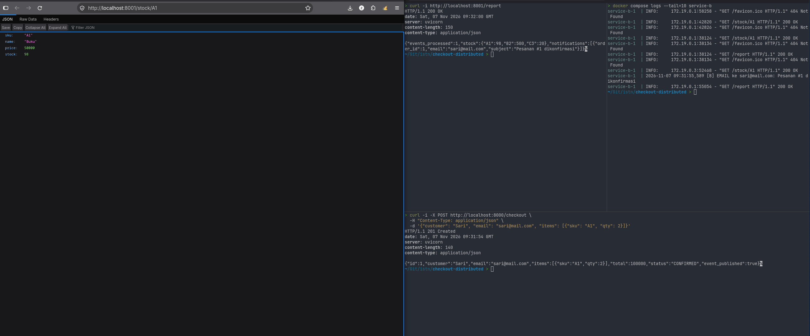
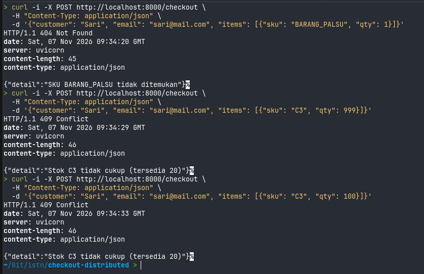
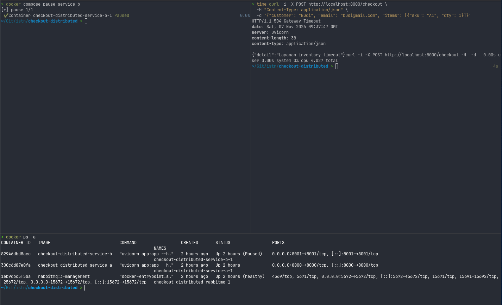
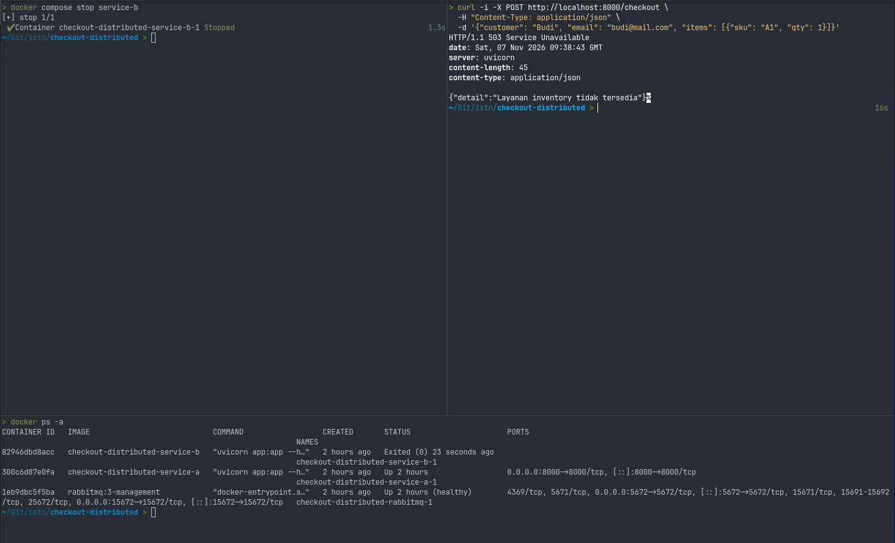
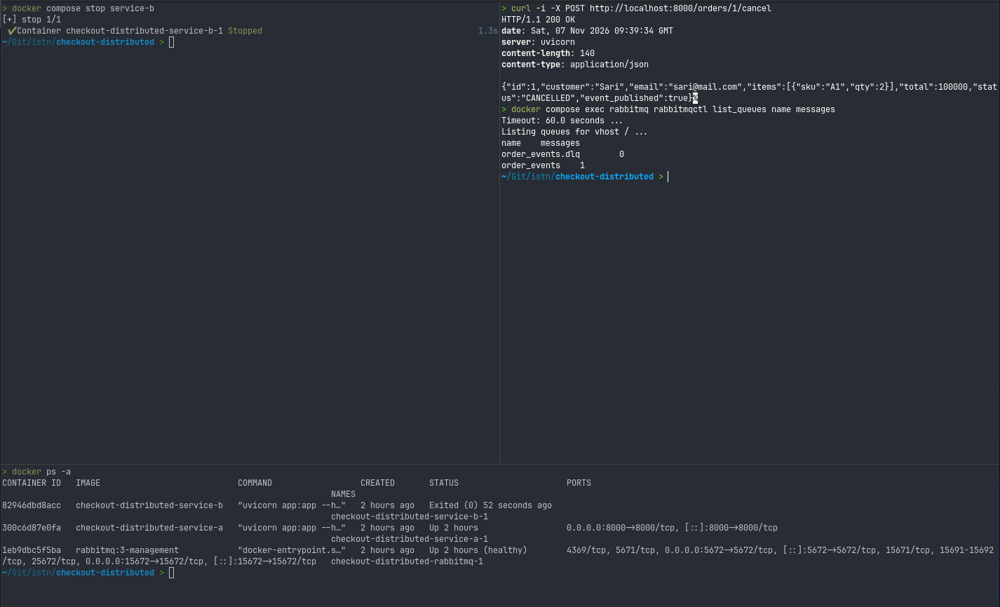
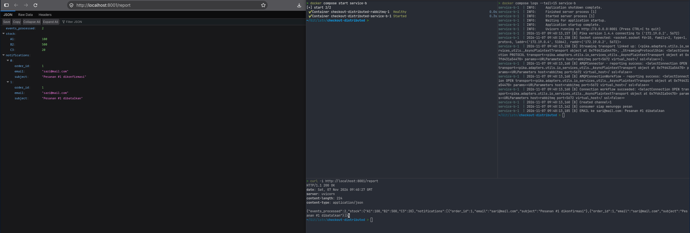
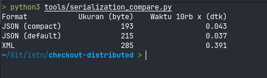

# Komunikasi Antar Layanan – Checkout Toko Online

## 1. Ringkasan

Dua layanan terpisah yang berkomunikasi **sinkron (REST + timeout)** dan **asinkron (RabbitMQ + ack)**, dijalankan dengan Docker Compose.

| Layanan | Peran | Port |
|---|---|---|
| **A – Order Service** (FastAPI) | Menerima checkout, cek stok (sinkron), otorisasi bayar, publish event | 8000 |
| **B – Inventory & Notification** (FastAPI + consumer) | Menyediakan data stok (REST), memproses event: kirim email (simulasi), update stok/laporan | 8001 |
| RabbitMQ | Broker pesan (queue durable + Dead-Letter Queue) | 5672 / 15672 |

## 2. Arsitektur

```
Klien --POST /checkout--> [Layanan A] --GET /stock/{sku} (sinkron, timeout 2 dtk)--> [Layanan B]
                              |                                                        ^
                              | publish order.created / order.cancelled                |
                              v                                                        |
                         [RabbitMQ: order_events] --consume + ack-----------------------+
                              | nack(requeue=false)
                              v
                         [order_events.dlq]
```

### Pemilihan pola (sesuai studi kasus di slide)

| Kebutuhan | Pola | Alasan |
|---|---|---|
| Cek stok barang | **Sinkron** (REST) | Hasilnya menentukan apakah checkout boleh lanjut; klien butuh jawaban seketika |
| Otorisasi pembayaran | **Sinkron** | Keputusan harus diketahui sebelum order dikonfirmasi |
| Kirim email, update laporan, info gudang | **Asinkron** (message queue) | Tidak perlu ditunggu klien; boleh tertunda; broker menyerap lonjakan |

## 3. Kontrak API dan kode status

**Layanan A**

| Metode | URL | Sukses | Galat |
|---|---|---|---|
| POST | `/checkout` | `201 Created` | 404 SKU tidak ada · 409 stok kurang · 402 bayar ditolak · 422 input salah · 503 B mati · 504 B timeout · 502 B error |
| GET | `/orders/{id}` | `200 OK` | 404 |
| POST | `/orders/{id}/cancel` | `200 OK` (murni asinkron) | 404 · 409 sudah dibatalkan |

**Layanan B**: `GET /stock/{sku}` (200/404), `GET /report` (200), `GET /health`.

## 4. Komunikasi sinkron

- Klien HTTP `httpx` dengan **timeout 2 detik** (`INVENTORY_TIMEOUT`).
- `GET /stock` bersifat idempoten, sehingga aman di-retry 1 kali (semantik *at-least-once*). Operasi tidak idempoten (POST) **tidak** di-retry otomatis.
- Pemetaan galat: timeout → **504**, tidak terjangkau → **503**, 5xx dari B → **502**, SKU tidak ada → **404**, stok kurang → **409**.

## 5. Komunikasi asinkron

- Queue `order_events` bersifat **durable**, pesan **persistent** (`delivery_mode=2`).
- Consumer memakai `prefetch_count=1` dan **`basic_ack` hanya setelah** pemrosesan selesai. Jika Layanan B mati saat memproses, pesan dikirim ulang oleh broker.
- **Idempoten**: tiap event punya `event_id` (`<order_id>:<jenis>`). Layanan B menyimpannya di tabel `processed` dalam satu transaksi SQLite bersama perubahan stok dan catatan notifikasi. Event duplikat dilewati (tetap di-ack), sehingga stok tidak berkurang dua kali.
- **Dead-Letter Queue** `order_events.dlq`: pesan rusak/gagal diproses di-`nack(requeue=false)` dan dipindahkan ke DLQ agar tidak berputar tanpa henti.
- Kegagalan publish tidak menggagalkan order; respons memuat `event_published: true/false`.

## 6. Serialisasi data

Semua pesan (REST dan antrean) memakai **JSON**, divalidasi dengan skema Pydantic (`CheckoutIn`, `ItemIn`) di sisi A. Hasil benchmark riil untuk satu event yang sama (`python3 tools/serialization_compare.py`, 10.000 iterasi):

| Format | Ukuran (byte) | Waktu 10rb x (dtk) |
|---|---|---|
| JSON (compact) | 193 | 0,043 |
| JSON (default) | 215 | 0,037 |
| XML | 285 | 0,391 |

Analisis: JSON lebih kecil sekitar 25–32% dan sekitar 10× lebih cepat dibanding XML pada data ini, serta terbaca manusia dan didukung secara universal, sehingga sangat ideal untuk REST API dan message broker. Protocol Buffers (biner, skema `.proto`) akan lebih ringkas lagi dan cocok untuk gRPC dengan konsekuensi memerlukan kompilasi skema `.proto` dan lebih sulit di-debug langsung. _(Bukti terminal benchmark dapat dilihat pada [Skenario 7](#skenario-7-benchmark-serialisasi-data-json-vs-xml))._

## 7. Cara menjalankan

```bash
docker compose up -d --build
# Swagger A: http://localhost:8000/docs   Swagger B: http://localhost:8001/docs
# RabbitMQ UI: http://localhost:15672  (guest / guest)
bash scripts/demo.sh        # demo otomatis semua skenario
docker compose logs -f service-a service-b
docker compose down -v
```

Contoh manual:

```bash
curl -X POST localhost:8000/checkout -H 'Content-Type: application/json' \
  -d '{"customer":"Sari","email":"sari@mail.com","items":[{"sku":"A1","qty":2}]}'
curl localhost:8001/report
```

Data awal stok: `A1` Buku (Rp50.000, 100), `B2` Pulpen (Rp5.000, 500), `C3` Tas (Rp250.000, 20).

## 8. Demo kegagalan Layanan B, pengujian, dan bukti screenshot

Berikut adalah rangkuman dan bukti eksekusi nyata dari pengujian skenario 1 hingga 7:

| # | Skenario | Perintah Utama | Hasil Nyata & Bukti |
|---|---|---|---|
| 1 | Normal (Sinkron & Asinkron) | `POST /checkout` | **201 Created**; B mencatat email, stok A1 berkurang 100 → 98 ([Screenshot 1](#skenario-1-checkout-normal-sinkron--asinkron)) |
| 2 | Input / Bisnis Salah | SKU salah / Stok kurang | **404 Not Found** & **409 Conflict** ([Screenshot 2](#skenario-2-penanganan-status-http--galat-bisnis-sinkron)) |
| 3 | Layanan B Hang (Pause) | `docker compose pause service-b` | **504 Gateway Timeout** setelah ±4 dtk (timeout 2s × 2 percobaan) ([Screenshot 3](#skenario-3-layanan-b-hang--freeze-timeout-sinkron-504)) |
| 4 | Layanan B Mati (Stop) | `docker compose stop service-b` | **503 Service Unavailable** ditolak cepat tanpa hang ([Screenshot 4](#skenario-4-layanan-b-mati--stop-kegagalan-sinkron-503)) |
| 5 | B Mati, Aksi Asinkron Jalan | `POST /orders/1/cancel` | **200 OK** tetap berhasil; pesan aman mengantre di RabbitMQ ([Screenshot 5](#skenario-5-layanan-b-mati-aksi-asinkron-tetap-berhasil-decoupling-200-ok)) |
| 6 | Pemulihan Layanan B | `docker compose start service-b` | Pesan antre otomatis dikonsumsi, stok A1 pulih jadi 100 ([Screenshot 6](#skenario-6-layanan-b-dihidupkan-kembali-recovery--konsumsi-antrean)) |
| 7 | Benchmark Serialisasi | `python3 tools/serialization_compare.py` | JSON compact & default ~10× lebih cepat dan ~30% lebih ringkas dari XML ([Screenshot 7](#skenario-7-benchmark-serialisasi-data-json-vs-xml)) |

---

### Skenario 1: Checkout Normal (Sinkron & Asinkron)
- **Aksi:** Klien memanggil `POST /checkout` untuk SKU `A1` sebanyak 2 unit.
- **Hasil:** 
  - Layanan A memvalidasi stok ke Layanan B secara sinkron dan mengembalikan respons `HTTP/1.1 201 Created` dengan atribut `"event_published": true`.
  - Pada browser dan endpoint `GET /report`, terlihat stok `A1` berkurang dari 100 menjadi `98`.
  - Log kontainer `service-b` memperlihatkan event diterima dari RabbitMQ dan notifikasi dicatat: `EMAIL ke sari@mail.com: Pesanan #1 dikonfirmasi`.



---

### Skenario 2: Penanganan Status HTTP & Galat Bisnis (Sinkron)
- **Aksi:** Menguji kasus batas dan input tidak valid pada pemanggilan sinkron:
  1. SKU tidak terdaftar: `BARANG_PALSU`.
  2. Kuantitas melebihi stok: `qty: 999` dan `qty: 100` untuk SKU `C3` (stok hanya tersedia 20).
- **Hasil:**
  - SKU salah menghasilkan `HTTP/1.1 404 Not Found` (`{"detail":"SKU BARANG_PALSU tidak ditemukan"}`).
  - Stok tidak cukup menghasilkan `HTTP/1.1 409 Conflict` (`{"detail":"Stok C3 tidak cukup (tersedia 20)"}`).



---

### Skenario 3: Layanan B Hang / Freeze (Timeout Sinkron 504)
- **Aksi:** Mensimulasikan *unresponsive server* / gangguan jaringan menggunakan `docker compose pause service-b`, kemudian klien mengirim pesanan dengan `time curl ...`.
- **Hasil:**
  - Status kontainer `service-b` berada pada status `Up (Paused)`.
  - Klien tertahan selama ±4.027 detik (2 percobaan × timeout 2 detik) dan menerima respons `HTTP/1.1 504 Gateway Timeout` (`{"detail":"Layanan inventory timeout"}`). Layanan A tidak ikut mati atau hang permanen.



---

### Skenario 4: Layanan B Mati / Stop (Kegagalan Sinkron 503)
- **Aksi:** Mematikan total Layanan B menggunakan `docker compose stop service-b`, lalu klien mencoba melakukan checkout.
- **Hasil:**
  - Status kontainer `service-b` adalah `Exited (0)`.
  - Permintaan langsung gagal dengan cepat tanpa menunggu timeout: `HTTP/1.1 503 Service Unavailable` (`{"detail":"Layanan inventory tidak tersedia"}`).



---

### Skenario 5: Layanan B Mati, Aksi Asinkron Tetap Berhasil (*Decoupling* 200 OK)
- **Aksi:** Dalam kondisi Layanan B masih mati (`Exited (0)`), klien membatalkan pesanan ID 1 melalui `POST /orders/1/cancel`.
- **Hasil:**
  - Permintaan tetap berhasil diproses dengan status `HTTP/1.1 200 OK` dan status order diubah menjadi `"CANCELLED"`.
  - Pengecekan antrean via `docker compose exec rabbitmq rabbitmqctl list_queues name messages` membuktikan pesan event pembatalan berhasil disimpan dan ditahan di antrean RabbitMQ (`order_events: 1`).



---

### Skenario 6: Layanan B Dihidupkan Kembali (*Recovery & Konsumsi Antrean*)
- **Aksi:** Menjalankan kembali Layanan B menggunakan `docker compose start service-b`.
- **Hasil:**
  - Worker consumer pada Layanan B secara otomatis menyambung kembali (*reconnect*) ke RabbitMQ dan memproses pesan pembatalan yang tertunda.
  - Log `service-b` mencatat `EMAIL ke sari@mail.com: Pesanan #1 dibatalkan`.
  - Pengecekan `GET /report` mengonfirmasi stok `A1` kembali dipulihkan menjadi `100` dan `events_processed` bertambah menjadi 2 (*Eventual Consistency* tercapai).



---

### Skenario 7: Benchmark Serialisasi Data (JSON vs XML)
- **Aksi:** Menjalankan skrip benchmark `python3 tools/serialization_compare.py` untuk mengukur payload ukuran byte dan waktu serialisasi sebanyak 10.000 iterasi.
- **Hasil:**
  - `JSON (compact)` : 193 byte | 0.043 detik.
  - `JSON (default)` : 215 byte | 0.037 detik.
  - `XML`            : 285 byte | 0.391 detik.
  - Format JSON terbukti lebih ringkas dan sekitar 10× lebih cepat dalam pemrosesan dibandingkan XML.



---

### Analisis perbandingan sinkron vs asinkron

| Aspek | Sinkron (REST) | Asinkron (RabbitMQ) |
|---|---|---|
| Saat B mati | Checkout **gagal** (503/504) | Pesan **tertahan** di broker, diproses saat B kembali |
| Ketergantungan waktu | A dan B harus hidup bersamaan | B boleh mati; hanya broker yang harus hidup |
| Latensi untuk klien | Bertambah sebesar waktu panggilan B | Hanya biaya publish ke broker |
| Kerumitan | Rendah | Lebih tinggi (broker, ack, idempotensi, DLQ) |
| Konsistensi | Jawaban langsung dan pasti | *Eventual consistency* (stok/email terlambat sesaat) |

Kesimpulan: pengecekan stok sengaja dibuat sinkron karena **keputusan bisnisnya butuh jawaban saat itu juga**, sehingga ia menjadi titik ketergantungan (single point of failure) terhadap B, dan itu dimitigasi dengan timeout, retry untuk operasi idempoten, serta kode galat yang jelas. Efek samping (email, laporan, gudang) dibuat asinkron agar tahan terhadap kegagalan B dan lonjakan trafik. Kelemahannya: ada jeda sebelum efek terlihat, dan pengirim harus siap pesan diproses lebih dari sekali, sehingga konsumen dibuat idempoten.

Keterbatasan yang diketahui: data order di A disimpan di memori (hilang saat A restart); publish ke broker belum memakai *outbox pattern*, sehingga jika broker mati tepat saat publish event bisa hilang (`event_published: false` hanya menandai, tidak mengulang).

## 9. Pemetaan ke rubrik

| Rubrik | Bukti |
|---|---|
| Dua layanan terpisah (25) | `service_a/`, `service_b/`, `docker-compose.yml` |
| Sinkron: status, timeout, galat (20) | Bagian 3–4, `check_stock()` di `service_a/app.py`, tangkapan layar `screenshoot/2.png`, `3.png`, `4.png` |
| Asinkron: ack & idempoten (20) | Bagian 5, `on_message()` dan `process_event()` di `service_b/app.py`, tangkapan layar `screenshoot/5.png`, `6.png` |
| Demo kegagalan & analisis (15) | Bagian 8, tangkapan layar `screenshoot/3.png` s.d. `6.png`, tabel analisis |
| Serialisasi (10) + repo & laporan (10) | Bagian 6 & Bagian 8 (Skenario 7), `tools/serialization_compare.py`, `screenshoot/7.png`, README ini |
